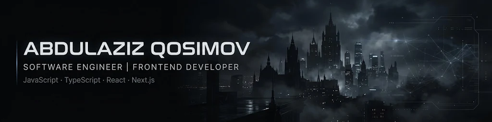
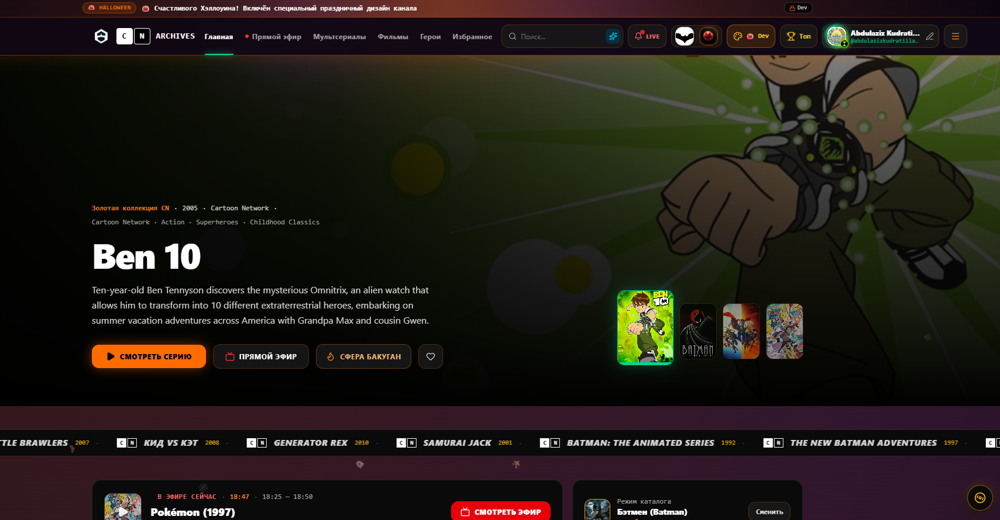
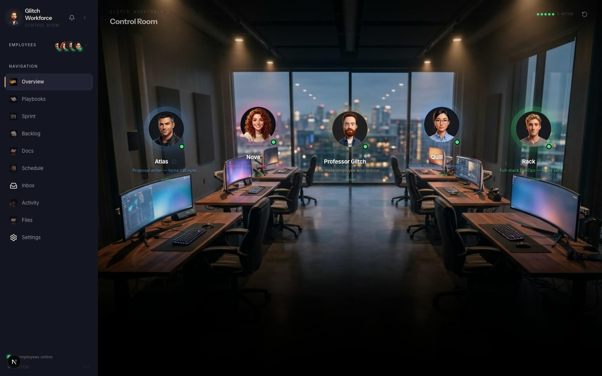
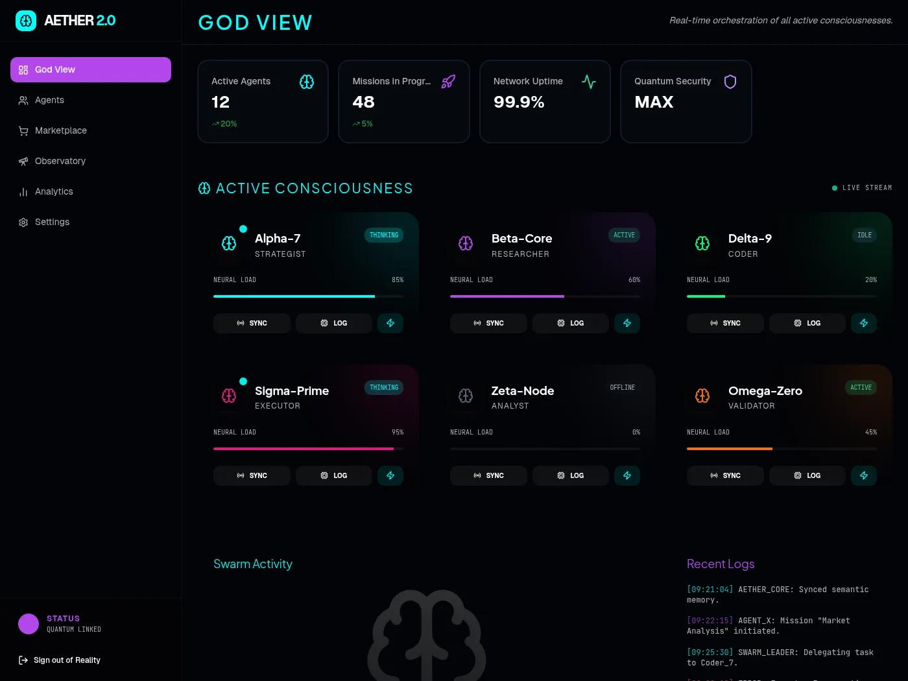

<!-- DAVID-PROFILE-BANNER -->

  

   

## 👨‍💻 Abdulaziz Qosimov (@AndyMagwayer) — Senior Software & Autonomous Systems Engineer

Разрабатываю авиационные симуляторы (Airbus A320), автономных AI-агентов (David AI, Anisa HQ) и высоконагруженные веб-платформы.

- 🌍 **Локация:** Ташкент, Узбекистан (UTC+5)
- 🤖 **Автономная оркестрация:** все репозитории находятся под круглосуточным контролем **David AI Autonomous Engineer**
- ✈️ **Флагманский стенд:** [Airbus A320 Flight Systems Simulator](https://a320-airplane-maga.netlify.app/)

### 🛠️ Технологический стек и инструменты

         

### 🖼️ Витрина флагманских продуктов и интерфейсов (Featured Showcases)

#### 1. 📺 [Cartoon Network Archives](https://github.com/AndyMagwayer/Cartoon-Network-Archives) — Цифровой медиа-архив и стриминг классики CN

  

#### 2. 🏢 [Anisa-HQ (AI Workforce Control Room)](https://github.com/AndyMagwayer/Anisa-HQ) — Виртуальная штаб-квартира автономных AI-сотрудников

  

#### 3. ⚡ [David AI Agent (God View Orchestrator)](https://github.com/AndyMagwayer/David-Ai-agent-) — Центр оркестрации репозиториев и нейронных агентов

  

### 🚀 Ключевые инженерные проекты и репозитории

| Проект | Архитектура и назначение | Статус David AI | Репозиторий |
| :--- | :--- | :---: | :---: |
| **[CN](https://github.com/AndyMagwayer/CN)** | Cartoon Network digital properties & assets | `🟢 Active 24/7` |  |
| **[A320-airplane](https://github.com/AndyMagwayer/A320-airplane)** | Interactive Airbus A320 flight systems and avionics simulation | `🟢 Active 24/7` |  |
| **[Cartoon-Network-Archives](https://github.com/AndyMagwayer/Cartoon-Network-Archives)** | Historical media preservation and broadcast archive | `🟢 Active 24/7` |  |
| **[Anisa-HQ](https://github.com/AndyMagwayer/Anisa-HQ)** | AI Operations Headquarters — виртуальная штаб-квартира автономных AI-агентов | `🟢 Active 24/7` |  |
| **[BAT-APP](https://github.com/AndyMagwayer/BAT-APP)** | Batch processing & automation tools application | `🟢 Active 24/7` |  |
| **[David-Ai-agent-](https://github.com/AndyMagwayer/David-Ai-agent-)** | David autonomous software engineer agent core & orchestrator | `🟢 Active 24/7` |  |

### 📊 Живая телеметрия инженера (Live Telemetry)

| Метрика | Значение | Статус верификации |
| :--- | :--- | :--- |
| 🔥 **Текущий стрик контрибуций** | **35 дней подряд** | `VERIFIED VIA GITHUB GRAPHQL` |
| 📈 **Контрибуций за год** | **2063+ коммитов и событий** | `ACTIVE PORTFOLIO` |
| ⚡ **Коммитов за сегодня** | **8** | `DAILY CHECKPOINT PASSED` |
| 🛡️ **Аптайм сервисов (Watchdog)** | **99.9% Online** | `REALTIME TELEMETRY` |
| 🕒 **Последняя синхронизация** | `11/10/2026, 09:05:11 (Asia/Tashkent)` | `DAVID AI DAEMON` |

---

  ⚡ Автоматически собрано и поддерживается <b>David Autonomous Software Engineer</b> для <a href="https://github.com/AndyMagwayer">Abdulaziz Qosimov (@AndyMagwayer)</a>

